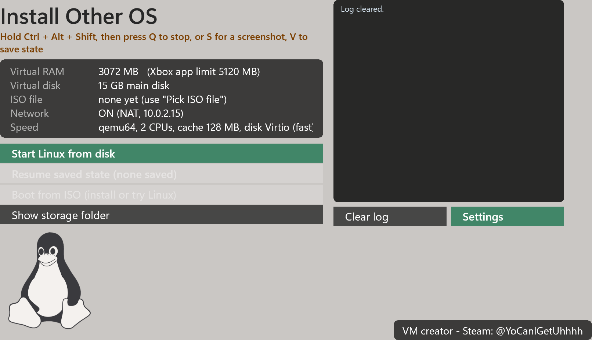
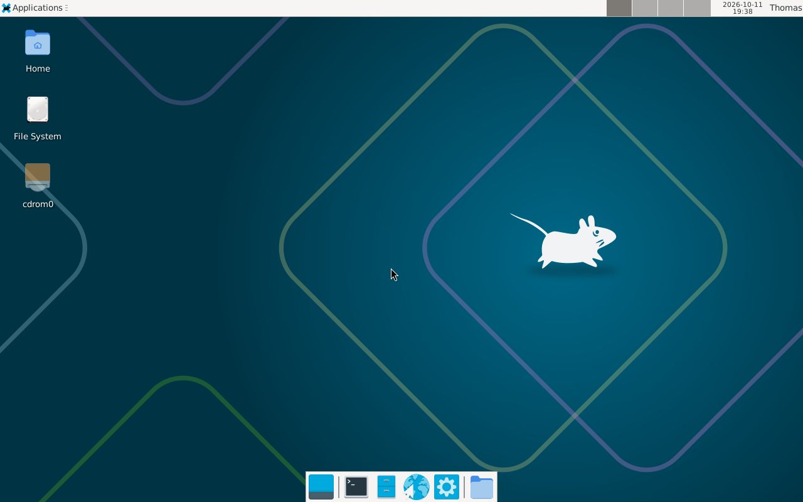

# Install Other OS

Run a full Linux inside an app on your **Xbox Series X|S in Developer Mode**.

The app uses [QEMU](https://www.qemu.org/) 10.0.0 to emulate a PC in software. No hypervisor is available to Xbox apps, so it is much slower than a real PC, but it is good enough for a light desktop (XFCE) and for small servers.

-107C10)

## Screenshots
**Main menu**

**Debian with the XFCE desktop running on the Xbox**

## What you need
- An Xbox Series X|S with **Developer Mode** turned on and the **Device Portal** enabled
- A PC or phone on the same network (to use the Device Portal in a web browser)
- An ISO of a Linux distro of your choice to install from (a small *netinst*-style image is a good fit). Debian 13 was used while building this.
- Optional: a USB keyboard. The Xbox pointer works as a mouse inside Linux.

## Download
No GitHub account needed: open the **[Releases page](../../releases/latest)** and download
- the `.msix` file, and
- the three x64 `.appx` dependency files.

## Install on the Xbox
1. On your PC open the Device Portal: `https://<your-xbox-ip>:11443`.
2. Open **My games & apps** (Apps manager) and use the **Add / Deploy** option.
3. Choose the `.msix` file, add the three x64 `.appx` files as dependencies, then start the install.
4. **Updating:** installing a newer version over an older one keeps your virtual disk and saved files.
5. **Going back to an older version:** the Xbox will not let you install an older version over a newer one. You have to uninstall the app first, and **uninstalling deletes your virtual disk** (your Linux install and everything on it). Back up anything you need before you do this.

This is a hobby project, so new builds are posted now and then, whenever there is something worth sharing. Every version stays on the **[Releases page](../../releases)**, so you can always find an older one.

## First start
1. Open **Install Other OS** on the Xbox, then press **Settings**.
2. Pick a disk size and press **Create virtual disk**.
3. Put your Linux ISO into the app's storage folder using the Device Portal (see below).
4. Turn **Network** on in Settings if you want internet inside Linux.
5. Back on the main menu press **Boot from ISO** and install your distro. A light, minimal install works best (Debian with the text installer and XFCE was used for testing).
6. After the install, use **Start Linux from disk**.

### Putting the ISO file on the Xbox (Device Portal)
1. On your PC open the Device Portal: `https://<your-xbox-ip>:11443`.
2. In the left menu click **File explorer**.
3. Click **LocalAppData**, then click **Microsoft.MicrosoftEdge.XboxVmHost_xkj04xcm6e7n4**, then click **LocalState**.
4. Under *Upload a file to the current folder* click **Choose file**, pick your `.iso`, then click **Upload**. Big ISOs take a few minutes. Wait until the upload finishes.
5. The file must sit directly in **LocalState** (not in a sub-folder) and its name must end in `.iso`.
6. In the app press **Show storage folder** to check that the ISO is listed. **Boot from ISO** uses the newest ISO in that folder.

(You can also try **Pick ISO file** in Settings to copy an ISO from a USB drive or another folder into the same place. This button has not been tested yet, but it should work. If it does not, use the Device Portal steps above.)

## Menu
| Button | What it does |
| --- | --- |
| Resume saved state | Continue exactly where you pressed the save hotkey |
| Start Linux from disk | Boot the installed system (asks before throwing away a saved state) |
| Boot from ISO | Boot the newest ISO in the app folder, to install or try Linux |
| Show storage folder | Lists the files in the app's storage |
| Settings | CPU type, code cache, CPUs, virtual RAM, network, disk and screen size |

The defaults are the recommended settings. Change one setting at a time.

## Keys while Linux is running
Hold **Ctrl + Alt + Shift**, then press:
- **V** save the state of the virtual PC and return to the menu
- **S** take a screenshot (saved in LocalState\screenshots)
- **Q** stop the virtual PC
- **D** show or hide the input counters

## Save state
Ctrl + Alt + Shift + V stops the virtual PC, saves its memory and devices to a file, and returns to the menu. **Resume saved state** loads it again, even after the app was closed. There is one saved state at a time. It is used up when you resume it, because Linux changes the disk afterwards. It is only valid for the same app version and an unchanged disk file.

## Good to know
- The virtual PC stops when the app leaves the foreground (Guide button, Home). Use save state first.
- QEMU can run once per app start; the app restarts itself when the virtual PC ends.
- There is no GPU acceleration. A light desktop such as XFCE works; heavy 3D does not.
- The Linux network card can change name when virtual devices change (for example `ens3` becomes `ens4`). If the network stops working after changing settings, look at `ip a` and fix the name in `/etc/network/interfaces`.
- Memory limit is set by the Xbox. Four CPUs or very large RAM settings can crash the app.

## Contact
Steam: [YoCanIGetUhhhh](https://steamcommunity.com/profiles/76561198072420605)

Progress posts: [Xbox VM running Linux](https://www.reddit.com/r/XboxRetailHomebrew/comments/1x1xrli/xbox_vm_running_linux/) and [Xbox VM update](https://www.reddit.com/r/XboxRetailHomebrew/comments/1x2pidd/xboxvmupdate/) on r/XboxRetailHomebrew.

## License and credits
This project is released under the **GNU General Public License v2** (see `LICENSE`), the same license as QEMU.
- [QEMU](https://www.qemu.org/) (GPL-2.0) and [libslirp](https://gitlab.freedesktop.org/slirp/libslirp) (BSD) provide the emulation and the user-mode network.
- Tux the penguin is the Linux mascot.
